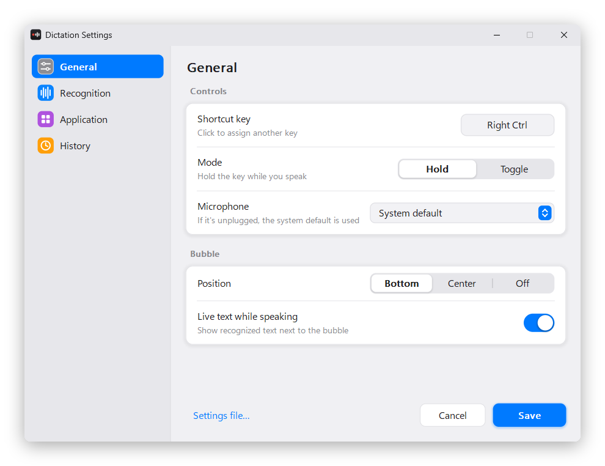

<div align="center">


# dictate

**Private, offline push-to-talk dictation for Windows.**<br>
Hold a key, speak, let go: the text is typed into whatever app you're in.<br>
Whisper runs on your own GPU. Nothing ever leaves your computer.

<a href="https://github.com/PabloSensei/dictate/releases/latest"></a>
<a href="https://github.com/PabloSensei/dictate/releases"></a>
<a href="LICENSE"></a>


<a href="https://github.com/PabloSensei/dictate/releases/latest"><b>Download</b></a> •
[Features](#features) •
[Quick start](#quick-start) •
[Usage](#usage) •
[Configuration](#configuration) •
[Privacy](#privacy-and-security) •
[Accuracy and speed](#accuracy-and-speed) •
[Building](#building-from-source) •
[FAQ](#troubleshooting)

<br>

<picture>
  <source media="(prefers-color-scheme: dark)" srcset="docs/bubble-dark.gif">
  
</picture>

</div>

## Why dictate?

Cloud dictation sends your voice to someone else's server. Most local apps are large
Electron bundles you have to take on trust. **dictate** is a small native Windows app
(one exe, about 4,500 lines of Rust) that you can read in an evening and build yourself:

- **It never touches the network.** The program has no networking code at all, so you can
  block it in the firewall and it keeps working.
- **It is fast.** A five-second phrase is recognized in about **0.16 s** on an RTX 4070 Ti
  with Whisper large-v3-turbo, and the model stays loaded, so there is no warm-up.
- **It works everywhere you type.** Text is entered as keyboard input into any window:
  editors, browsers, chat apps, terminals. The clipboard is never used.
- **It stays out of the way.** It lives in the tray. A small animated bubble shows that it
  is listening, and optionally the words as you say them.

## Features

- 🎙️ **Push-to-talk or toggle.** Hold the key while you speak, or tap once to start and once
  to finish. Esc cancels. Shortcuts like Right Ctrl + C keep working.
- 💬 **Live preview.** See the recognized text under the bubble while you are still speaking.
- 🌍 **Many languages.** Whisper understands about 100 of them, and it handles speech that
  mixes languages, such as Russian with English technical terms.
- 🧠 **Vocabulary hints.** Give the model a short prompt with your names and jargon, and it
  will spell them your way.
- ✏️ **Autocorrect rules.** `replace = cube control => kubectl` fixes words the model
  keeps getting wrong.
- 🔇 **Voice activity detection.** Silero VAD skips silence and noise, so Whisper doesn't
  invent text for an accidental key press.
- ⚙️ **Native settings window.** Inspired by macOS, with light and dark themes and live
  switching between English, Русский, Polski, and Українська.
- 🚀 **Start with Windows.** One switch, per user, no admin rights needed.

<p align="center">
  <picture>
    <source media="(prefers-color-scheme: dark)" srcset="docs/settings-dark.png">
    
  </picture>
</p>

## Quick start

**1. Download** the zip for your hardware from
[**Releases**](https://github.com/PabloSensei/dictate/releases/latest) and unpack it anywhere,
for example to `%LOCALAPPDATA%\Programs\dictate`. There is no installer: settings and models
stay inside that folder. Every zip has a `.sha256` file next to it.

| Download | For | Model | Time per phrase |
|---|---|---|---|
| `dictate-…-windows-x64-cuda.zip` (580 MB) | NVIDIA GeForce RTX 20 series or newer, driver 580+ | large-v3-turbo | ~0.2 s |
| `dictate-…-windows-x64-cpu.zip` (2 MB) | Any x64 CPU with AVX2, no GPU needed | small | 2–5 s |

Most of the CUDA zip is NVIDIA's cuBLAS library, which the GPU build needs.

**2. Get the models.** Double-click `download-models.cmd`. It downloads the Whisper model
for your zip and the Silero voice activity detector from Hugging Face, and checks their
SHA-256.

**3. Run `dictate.exe`**, click into any text field, hold **Right Ctrl**, speak, and release.

> [!NOTE]
> The exe isn't code-signed yet, so SmartScreen may warn about an unknown publisher on
> the first run. Click **More info**, then **Run anyway**. You can also
> [build it yourself](#building-from-source) from this source.

> [!TIP]
> Left-click the tray icon to open the settings, where you can pick another key or your
> language. Setting the speech language explicitly is more reliable than auto-detection on
> short phrases.

### Requirements

| | Requirement |
|---|---|
| **OS** | Windows 10 or 11, 64-bit |
| **GPU** | NVIDIA RTX 20 series or newer with about 2 GB of free VRAM (recommended). The CPU build works without one, just slower and with a smaller model. |
| **Disk** | CUDA build: 0.8 GB unpacked + 1.6 GB model. CPU build: 5 MB + 0.5 GB model. |

## Usage

| | How |
|---|---|
| **Dictate** | Hold the hotkey (default **Right Ctrl**) and speak. Release it to type the text. |
| **Toggle mode** | Tap to start, tap again to finish. **Esc** cancels. |
| **Settings** | Left-click the tray icon, or run `dictate.exe` again. |
| **Tray menu** | Right-click: settings, interface language, start with Windows, log, restart, quit. |

The **tray icon** shows the state at a glance: 🟠 loading the model, ⚪ ready,
🔴 listening, 🔵 recognizing, 🟣 error (hover over it for details).

The **bubble** appears on the monitor where your mouse is, at the bottom or in the center
of the screen. It never takes focus and lets clicks pass through. In hold mode it only shows
up after `min_hold_ms`, so ordinary shortcuts like Ctrl + C don't make it flash.

## Configuration

Everything is in `dictate.ini` next to `dictate.exe`, created on the first run with a
comment for every option. The settings window edits the same file and keeps your comments.

| Key | Default | What it does |
|---|---|---|
| `model` | `models\ggml-large-v3-turbo.bin` | Whisper model in GGML format. Relative paths start at the ini file. |
| `model_sha256` | *(turbo's hash)* | Checked on every start. Leave it empty for your own models. |
| `vad_model` | `models\ggml-silero-v6.2.0.bin` | Silero voice activity detector. Leave it empty to turn VAD off. |
| `language` | `auto` | `en`, `ru`, `de`, `pl`, `uk`, … or `auto` |
| `prompt` | *(empty)* | Style and vocabulary hint, e.g. `Hi! Notes: Kubernetes, PostgreSQL, Grafana.` |
| `replace` | — | Autocorrect rule `heard => wanted`. Repeat the line for more rules. |
| `hotkey` | `RCtrl` | `RCtrl` `LCtrl` `RAlt` `RShift` `LShift` `Apps` `F1`–`F24` `Pause` `ScrollLock` `Insert` `XButton1` `XButton2` `MButton`, or `0xA3` |
| `mode` | `hold` | `hold` or `toggle` |
| `min_hold_ms` | `300` | Shorter presses are ignored in hold mode. |
| `max_record_s` | `120` | Recording stops after this many seconds. |
| `beam_size` | `5` | `1` is greedy and fastest; `5` is a bit more accurate. |
| `use_gpu`, `threads` | `true`, `4` | GPU on or off; CPU threads |
| `append_space` | `true` | Adds a space after each phrase. |
| `overlay` | `bottom` | Bubble position: `bottom`, `center` or `off` |
| `live_preview` | `true` | Shows text under the bubble while you speak. |
| `ui_language` | `auto` | `auto` follows Windows; or `en`, `ru`, `pl`, `uk` |

<details>
<summary><b>Prompt and autocorrect rules in detail</b></summary>

<br>

**Prompt.** Whisper continues the style of the text it is given. A prompt with your
punctuation and spelling, plus the names and terms you use, nudges it toward writing them
the same way. For mixed-language speech, a prompt that already mixes the languages helps
the most:

```ini
prompt = Привет! Текст по-русски, термины по-английски: Docker, GitHub, pull request.
```

**Autocorrect rules** fix what a prompt can't. Matching ignores case (and Russian ё/е),
works on whole words only, and a space also matches a hyphen. If the matched text starts
with a capital letter, so does the replacement:

```ini
replace = cube control => kubectl
replace = graph ana => Grafana
```

</details>

## Privacy and security

dictate was written for people who would rather not trust a dictation app blindly.

- **No network code.** The exe imports only audio (`winmm`), windowing (`user32`, `gdi32`,
  `dwmapi`, `shell32`), and CUDA. `dumpbin /imports` shows no `ws2_32`, `wininet`, or
  `winhttp`. The only download is `download-models.cmd`, a short script you run yourself.
- **The microphone is open only while you dictate**, so the Windows microphone indicator is
  lit only then. Audio stays in memory and is never written to disk.
- **No keyboard hook.** One key is polled with `GetAsyncKeyState`. Text is typed with
  `SendInput` (Unicode), and the clipboard is never read or written.
- **Verified models.** Model files are checked against a SHA-256 hash on every start.
  `tools/convert_hf_to_ggml.py` converts Hugging Face `safetensors` checkpoints using only
  numpy: no pickle, no PyTorch, no remote code.
- **The log contains no text.** `%LOCALAPPDATA%\dictate\dictate.log` records only
  timings and errors.
- **Nothing runs elevated.** Autostart is one value under `HKCU\…\Run`.

> [!NOTE]
> Windows doesn't let a normal app type into windows that run as administrator (UIPI).
> Dictation into elevated apps needs dictate to run elevated too.

## Accuracy and speed

Measured with Whisper large-v3-turbo on an RTX 4070 Ti, using `dictate-bench` on 20 phrases
of conversational Russian full of English technical terms (one speaker, about 5 s each):

| Setup | WER | Time per phrase |
|---|---:|---:|
| Beam search 5 + prompt (default) | 11.3% | 159 ms |
| Greedy decoding + prompt | 12.3% | 125 ms |
| Beam search 5 + prompt + 2 autocorrect rules | 10.3% | 159 ms |
| Beam search 5, no prompt | 13.7% | — |

Here WER counts "Docker" written as "докер" as an error, which is exactly what a prompt
fixes. Several Russian fine-tunes of Whisper did no better than the official turbo model
with a prompt, and they did worse without one. The live preview re-recognizes the last ~12 s
about every 0.4 s, taking 80–160 ms per update. The app uses about 2 GB of VRAM and
0.5 GB of RAM.

### Benchmark your own voice

Your voice and vocabulary matter more than any published benchmark. `dictate-bench`
records your phrases and then compares models on them:

```powershell
$app = "$env:LOCALAPPDATA\Programs\dictate"
& $app\dictate-bench.exe record my-voice .\bench\phrases-en.txt   # Enter starts and stops each phrase
& $app\dictate-bench.exe run my-voice $app\models\ggml-large-v3-turbo.bin D:\other-model.bin --lang en
```

`run` prints WER, CER, and milliseconds per phrase for each model, and saves every
transcript to a TSV file. Any whisper.cpp GGML model works: [ggerganov/whisper.cpp](https://huggingface.co/ggerganov/whisper.cpp)
has the official ones from `tiny` to `large-v3`. To use a Hugging Face fine-tune, convert it
with `tools/convert_hf_to_ggml.py`.

## Building from source

You need Rust, Visual Studio Build Tools (C++), CUDA Toolkit 12 or 13 (only for the CUDA
build), and LLVM for libclang. In **PowerShell**:

```powershell
winget install Rustlang.Rustup
winget install Microsoft.VisualStudio.2022.BuildTools --override "--wait --passive --add Microsoft.VisualStudio.Workload.VCTools --includeRecommended"
winget install Nvidia.CUDA
winget install LLVM.LLVM
```

`build.ps1` loads the MSVC developer environment, finds libclang, and runs
`cargo <command> --release`. Run these from the repository folder:

```powershell
.\build.ps1                               # dictate.exe + dictate-bench.exe, CUDA for this PC's GPU
.\build.ps1 build --no-default-features   # CPU-only: no CUDA Toolkit needed
.\build.ps1 test                          # unit tests
.\build.ps1 clippy --all-targets
.\install.ps1                             # copy to %LOCALAPPDATA%\Programs\dictate and start
.\download-models.ps1                     # models for that installed copy
.\package.ps1                             # the portable release zips (CUDA + CPU)
```

The first build takes a while because it compiles the CUDA kernels; rebuilds take seconds.

<details>
<summary><b>Build details</b></summary>

<br>

- **CUDA architectures.** `build.ps1` compiles kernels only for the GPU in your PC
  (`CMAKE_CUDA_ARCHITECTURES = "native"` in `.cargo/config.toml`), and ggml's CPU code for
  your CPU. `package.ps1` builds portable binaries instead: AVX2 CPU code, kernels for
  Turing, Ampere, Ada, and Blackwell plus PTX for newer GPUs, and it ships cuBLAS and the
  MSVC runtime next to the exe.
- **libclang.** bindgen regenerates whisper.cpp's bindings on Windows, because the ones
  bundled with `whisper-rs-sys` are generated on Linux and have the wrong struct layouts.
  `build.ps1` looks in `%ProgramFiles%\LLVM\bin` and in Visual Studio's LLVM component, or
  you can set `LIBCLANG_PATH` yourself.
- **cuBLAS.** CUDA builds load `cublas64_*.dll` and `cublasLt64_*.dll`. `install.ps1`
  copies them next to the exe when the CUDA Toolkit isn't in `PATH`.
- **Tests.** `.\build.ps1 test --lib autostart '--' --ignored` also runs a test that writes
  to the real `HKCU\…\Run` key and cleans up afterwards.

</details>

<details>
<summary><b>Project layout</b></summary>

<br>

| Path | What's inside |
|---|---|
| `src/main.rs` | Tray icon, hotkey thread, engine thread, single instance |
| `src/engine.rs` | whisper.cpp wrapper: VAD crop, padding, hallucination filter, live preview |
| `src/trigger.rs` | Hold/toggle state machine for the hotkey (unit-tested) |
| `src/audio.rs` | 16 kHz mono capture with `waveIn`, level meter, live buffer |
| `src/inject.rs` | Unicode `SendInput` typing |
| `src/overlay.rs`, `src/bubble.rs` | Layered click-through window and its SDF renderer |
| `src/settings.rs`, `src/paint.rs` | Custom-painted settings window |
| `src/config.rs` | `dictate.ini` parsing and in-place saving that keeps comments |
| `src/i18n.rs` | Interface strings in four languages (a test checks they are complete) |
| `src/replace.rs` | Autocorrect rules |
| `src/autostart.rs` | Start with Windows (`HKCU\…\Run`) |
| `src/bin/bench.rs` | `dictate-bench`: record, compare models, render the bubble |
| `tools/convert_hf_to_ggml.py` | Hugging Face → GGML converter without PyTorch |

</details>

## Troubleshooting

<details>
<summary><b>Nothing is typed in one particular app</b></summary>

<br>

That app probably runs as administrator; see the note under
[Privacy and security](#privacy-and-security). A notification and the log say
`input blocked` when this happens.
</details>

<details>
<summary><b>The tray icon is purple</b></summary>

<br>

Something failed at startup, most often a missing model or a checksum mismatch. Hover over
the icon or open **Log** from the tray menu. `download-models.cmd` fetches the default
models again.
</details>

<details>
<summary><b>Short phrases come out in the wrong language</b></summary>

<br>

Set **Speech language** in the settings instead of auto-detection. Whisper needs a few
seconds of audio to detect a language reliably.
</details>

<details>
<summary><b>A word is always misspelled</b></summary>

<br>

Add it to the prompt. If that's not enough, add a `replace = … => …` rule.
</details>

<details>
<summary><b>Pressing Right Alt opens the menu bar in some apps</b></summary>

<br>

dictate sends a harmless masking key to prevent that. If an app still reacts, pick another
key, such as Right Ctrl, a function key, or a mouse side button.
</details>

## Acknowledgements

- [whisper.cpp](https://github.com/ggml-org/whisper.cpp) by Georgi Gerganov and
  contributors, the inference engine.
- [OpenAI Whisper](https://github.com/openai/whisper), the speech recognition model.
- [whisper-rs](https://codeberg.org/tazz4843/whisper-rs), the Rust bindings.
- [Silero VAD](https://github.com/snakers4/silero-vad), the voice activity detector.
- [windows-sys](https://github.com/microsoft/windows-rs), the Win32 API bindings.

## License

[MIT](LICENSE). The models have their own licenses: Whisper is MIT and Silero VAD is MIT.
